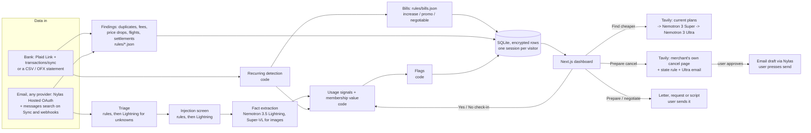

# ClawBack architecture

Status markers used here:
- **[built]**: in the prototype.
- **[live]**: built, and checked at least once against the real service (Token Factory, Tavily).
- **[stub]**: the code path exists but is untested or partial.
- **[MISSING]**: not started.

[STATUS.md](../STATUS.md) has the item-by-item list, and the dashboard's build board (`backend/clawback/features.py`)
gives every feature's phase with its evidence.

## 1. What it does

ClawBack looks for money in a person's own bank and email data. It finds every subscription and bill they pay for,
works out whether each one is worth it **for how they use it**, spots one-time money they are owed (duplicate
charges, bank fees, store price drops, flight refunds, class-action settlements), and does the legwork. Rocket Money
lists what you pay. ClawBack adds the usage side and the money owed, and then prepares the action:

| Situation | What ClawBack says | What it does |
|---|---|---|
| Membership costs more than it saves | "DashPass cost $9.99; 1 order saved you $2.99. Net -$7.00." | Break-even math, then cancel prep |
| Service looks unused | "Hulu sent a 'we miss you' email. It costs $9.99/month." | Asks to confirm, then cancel prep |
| Two plans do the same job | "You pay for iCloud+ and Google One storage." | Suggests keeping one |
| Trial about to convert | "Super Duolingo trial ends tomorrow, then $12.99/month." | Cancel prep before the charge |
| Price went up | "Netflix went from $15.49 to $17.99 on Sep 5." | Cheaper tier / alternatives |
| No usage evidence at all | "Did you use Adobe this month?" (one tap) | Remembers the answer |
| A bill stepped up | "Xfinity went from $55.00 to $85.00 a month (+55%). Your promotional rate ended Aug 8." | Negotiation script |
| Charged twice | "Best Buy charged $129.99 twice. Your email has one order." | Dispute letter (FCBA / Reg E) |
| A bank fee | "Overdraft fee: $35.00." | Courtesy-reversal request |
| A store dropped its price | "You paid $199.99; it's $169.99 now. Ask Target for $30 back by Oct 30." | Price-adjustment request |
| A flight was cancelled | "United cancelled UA 1532. You can ask for $412.40 back in cash." | Refund request citing the DOT rule |
| A settlement may apply | "You may qualify for the Kroger Savings Club settlement. Claim by Dec 21." | Official claim link only |

**ClawBack never cancels, sends, disputes or files anything itself.** It prepares the cancel link, the letter, the
request or the script (and can save the email as a draft in the user's own mailbox), and the user does the final click. That rule avoids three problems:
- holding everyone's passwords;
- wrong cancellations, such as stopping someone's phone backups;
- Google's requirement that users confirm agent actions on Workspace data.

**No affiliate money.** Recommendations are never paid placements.

## 2. Scope

**Hackathon demo (by 2026-10-30):** five areas from the same data (widened on 2026-10-22): subscriptions, bills,
bank charge problems, refunds owed, and class-action settlements (see §7). Bank data comes from Plaid's test bank
(the team chose not to apply for Production, 2026-10-23) or a CSV / OFX upload, and email from any provider through
Nylas (Sandbox: 5 accounts). It also includes the subscription flags above, check-ins, "Find cheaper", "Prepare
cancel" with drafts, the findings with their prepared actions, the model trace, and a private demo session for every
visitor (no login).

**Roadmap:**
- a forwarding address for mail that can't be connected;
- the browser extension;
- usage data from service APIs;
- a trained email classifier;
- alerts by email or push (in-app alerts are built).

## 3. System overview

Everything that touches money or dates is plain code. Models only:
- read unstructured text (emails, plan pages);
- weigh options against usage;
- write wording.

A model never computes a date, a total or a deadline.

## 4. Data sources

### Bank and card transactions (the full subscription list)
- **Plaid** [built, untested live] (`backend/clawback/sources/plaid.py`, plain REST over httpx):
  - `POST /api/connect/plaid/link-token` calls `/link/token/create` (products `transactions`, 180 days, US, English).
  - Link runs in the browser and hands back a `public_token`. `POST /api/connect/plaid/exchange` swaps it for an
    access_token via `/item/public_token/exchange` and saves it, encrypted (Fernet, `CLAWBACK_SECRET_KEY`).
  - Then the `/transactions/sync` cursor loop runs while `has_more`, applying added / modified / removed. A brand-new
    Item is often not ready: the first sync retries for about 15 s, then answers `pending: true` so the user can press
    Sync later. If Plaid reports a mutation during pagination, the loop restarts from its starting cursor.
  - Plaid amounts are positive for money out, the same as ours. The description is `merchant_name`, except that raw
    names our matchers rely on (`APPLE.COM/BILL`, `GOOGLE *...`, known merchants) are kept.
  - Liabilities is asked for as an optional product. Each sync first calls `/liabilities/get` (best effort) for the
    account types and each credit card's `last_statement_issue_date`, which sets the real dispute deadline.
  - Transactions are saved in the database with the rest of the user's data.
  - Disconnect calls `/item/remove` (best effort) and drops the bank's transactions.
  - [built] The webhook: with `PUBLIC_API_URL` set, Link tokens carry `{PUBLIC_API_URL}/api/ingest/plaid/webhook`.
    The `Plaid-Verification` JWT is checked (ES256, key from `/webhook_verification_key/get`, `iat` under 5 minutes,
    body SHA-256); `SYNC_UPDATES_AVAILABLE` pulls, and ITEM errors mark the bank as needing a reconnect.
  - Not planned: Production access and OAuth banks (Chase, Capital One and others need a redirect URI in Link plus a
    return page). The team chose the test bank on 2026-10-23.
  - Sandbox is free (test login `user_good` / `pass_good`; `user_transactions_dynamic` gives livelier data).
  - Plaid's `/transactions/recurring/get` is a paid add-on, so ClawBack uses its own recurring detection (below).
- **Statement upload** [built]: works with no approvals. CSV handles common column names, a single amount column of
  either sign, and separate debit/credit columns. OFX and QFX (1.x SGML and 2.x XML) use FITID for stable ids, so the
  same file twice adds nothing.
- **App-store billing** [built]: Apple and Google bill many subscriptions, which show up as `APPLE.COM/BILL` or
  `GOOGLE *`. No third-party API lists them. `pipeline/store_billing.py` reads Apple receipts (2025 and older
  layouts), Apple subscription confirmations and Google Play receipts, and matches each charge by total or price plus
  tax within a few days. Bundles split per app, several apps in one Apple series are told apart, and a charge with no
  receipt stays "Apple (unmatched)". Lightning reads layouts the code can't.

### Email (usage evidence, trials, receipts)
- **Any inbox through Nylas v3** [built, untested live] (`backend/clawback/sources/nylas.py`, plain REST over httpx).
  One "Connect email" button covers Gmail, Outlook / Hotmail / Microsoft 365, Yahoo, iCloud and other IMAP inboxes.
  - `GET /api/connect/email` returns the Nylas Hosted OAuth URL (`{NYLAS_API_URI}/v3/connect/auth`, `response_type=code`,
    `access_type=online`, an optional `login_hint`, and a random single-use `state` that expires after 10 minutes).
    No `provider` is sent, so Nylas shows its provider picker. The user signs in on the provider's own page.
  - Nylas redirects to `GET /api/connect/email/callback`. It checks the `state` and swaps the code at
    `POST /v3/connect/token` (client id, the API key as client secret) for a `grant_id`. The address and provider come
    from that response, or from `GET /v3/grants/{id}` when the response leaves them out. Then it saves the grant,
    reads mail, runs the pipeline, and redirects to `{FRONTEND_ORIGIN}/dashboard?connected=email` or
    `/dashboard?connect_error=<message>`.
    Nylas holds the provider tokens; ClawBack keeps only the grant id.
  - Reading: `GET /v3/grants/{id}/messages`, newest first, paged with `page_token` / `next_cursor`, up to
    `EMAIL_MAX_MESSAGES` (default 150) from the last 180 days. Nylas allows only `in`, `limit` and `page_token` next to
    `search_query_native` for Google and Microsoft, so:
    - Google: a Gmail-syntax search with `newer_than:180d` inside the query;
    - Microsoft: KQL keywords (Graph `$search`); the 180-day cut is made from each message's `date`;
    - Yahoo, iCloud, IMAP, EWS, or a native search the provider refuses: `received_after` plus the triage keyword rules,
      looking at up to 500 messages.
  - Each message keeps the first `from[].email`, `subject` and `date` (unix seconds). `body` is HTML when the message has
    an HTML part; it is stripped to text and cut to 5,000 characters, falling back to `snippet`. Bodies stay in memory.
  - A 401 / 404 on the grant marks the connection as needing a reconnect ("Connect email" again re-authenticates the
    same grant). A 429 waits for `Retry-After`, or backs off, and retries. Requests to one grant run one at a time.
  - Disconnect deletes the grant at Nylas (best effort) and drops the emails from memory. Connecting a different inbox
    deletes the old grant, because the Sandbox counts every grant toward its limit of 5.
- **Email drafts** [built, untested live]: `POST /v3/grants/{id}/drafts` with subject, plain-text body and `to` only
  when it's a real address. Never sends. A permission refusal marks the connection as needing re-consent; reading keeps
  working. Drafts need a write scope: Gmail `gmail.compose` (Gmail also accepts `gmail.modify`, which the Sandbox
  connector has), Microsoft `Mail.ReadWrite`.
- **Email webhooks** [built, untested live]: `GET /api/ingest/email/webhook?challenge=` echoes the challenge;
  `POST` checks `X-Nylas-Signature` (HMAC-SHA256 with `NYLAS_WEBHOOK_SECRET`). `message.created` reads that one
  message in the background, keeps it if triage does, and re-runs; `grant.expired` / `grant.deleted` mark a reconnect.
- **Attachments** [built]: receipt PDFs and images are downloaded (5 MB cap, type checked by magic bytes, in memory
  only) for `findings/receipts.py`.
- **Nylas production** [MISSING]: the free Sandbox allows 5 connected accounts and isn't for production use.
  - Mail passes through Nylas, a third-party processor; `docs/PRIVACY.md` says so.
  - Gmail in production also needs either our own Google project with Google verification + CASA (restricted
    scopes, renewed yearly) or Nylas's verified shared Google app (a paid add-on).
  - Google's Limited Use rules still apply to Gmail data: no training general models on user mail, a privacy policy
    that says so, a prompt-injection guard, and user confirmation for agent actions.
- **Forwarding address** [MISSING, P2]: a free Cloudflare Email Worker receives forwarded receipts from any provider.
  It can't write drafts into the user's mailbox, so the claim is emailed back to the user instead.
- iCloud and plain IMAP inboxes usually sign in with an app password on Nylas's page. ClawBack never sees it, but it
  gives Nylas full mailbox access, which the privacy policy should state.

## 5. Pipeline

| # | Stage | Engine | Runs on | Status |
|---|---|---|---|---|
| 1 | Triage: drop email that can't be about money | Sender + keyword rules; a cached **Lightning** yes or no for unknown senders (at most 200 a run) | every email | [live] |
| 1b | Injection screen | Rules for instruction-like text, hidden text and encoded blobs; **Lightning** for borderline mail. A flagged email goes to the rules only | before every model call on email | [live] |
| 2 | Extraction: email -> facts (kind, merchant, amount, savings, old/new price, trial end) | **Nemotron 3.5 Lightning** (`nvidia/Nemotron-3_5-Lightning`), Nano backup, regex fallback; cached per email; values kept only if the email writes them | triage survivors | [live] |
| 2b | Receipts as PDFs/images | pypdf text + **Lightning**; images (and scans, when pypdfium2 loads) to **Nemotron 3.5 Super-VL** | attachments | [built]; model reads [live] on made-up receipts |
| 3 | Recurring detection | code: steady cadence (weekly to yearly, quarterly too), one-off charges ignored, renamed descriptors merged; rent, loans, copays and transfers set aside | all transactions | [built] |
| 3b | Merchant names | `rules/merchants.json` (153 entries); **Lightning** names the rest from the descriptor, cached | recurring charges | [live] |
| 4 | App-store resolution | code: Apple and Google Play receipts by total or price plus tax; Lightning for odd layouts | `APPLE.COM/BILL`, `GOOGLE *` | [built] |
| 5 | Usage signals and learning | code (see §6) | each subscription | [built] |
| 6 | Membership value | code: savings from receipts minus the fee, cautious and generous estimates | DashPass, Uber One, Instacart+, Walmart+, Grubhub+, Prime | [built] |
| 7 | Flags | code | each subscription | [built] |
| 7b | Confirmation | code: a cancelled charge that stops, a charge after cancelling, a refund credit for a finding marked done | each sync | [built] |
| 8 | Find cheaper | **Tavily** search, **Nemotron 3 Super** reads the plans, **Nemotron 3 Ultra** (thinking on) fits them to usage, then a code citation check | on request | [live] |
| 9 | Prepare cancel | **Tavily** for the merchant's own cancel page (domain-checked, steps quoted from the page), the state rule, one checked link and a calendar reminder; **Ultra** writes an email only when the merchant's page lists an address (template fallback), a Nylas draft | on request | [live]; draft [built] |
| 10 | Bills: classify + flag | code + `rules/bills.json` | recurring charges | [built] |
| 11 | Purchases and flight details from email | **Lightning** in strict JSON, Nano backup, regex rules; grounded in the email | receipt / order / airline emails | [live] |
| 12 | Findings: duplicates, fees, price drops, flights, settlements | code + `rules/*.json`; price checks with Tavily + Lightning | all transactions and emails | [built]; price checks [live] |
| 13 | Letters and scripts | **Ultra** from facts code worked out; every number, date and link checked; template fallback | on request | [live] |

The funnel matters for cost:

$$C \approx N\,(c_{rules} + p\,c_{Lightning}) + k\,c_{Ultra}$$

- $N$: number of emails; $p$: share that survives triage; $k$: number of user-requested "find cheaper" runs.
- Measured on the synthetic eval set (`docs/EVAL.md`, 2026-10-23 baseline): about **$0.026 per 1,000 emails** for the
  whole pipeline, and $0.015 for extraction alone. Sending every email to Ultra instead came to about $1.18 per 1,000,
  roughly 78 times more.
- With about 1,000 input and 150 output tokens per email, Lightning costs about **$0.0001 per email**,
  so 1,000 emails cost about $0.10.
- An Ultra "find cheaper" call (~3k in, ~1.5k out) costs about **$0.0075**.
- A hosted ModernBERT classifier on the smallest Nebius CPU endpoint is about $0.066/h, roughly $1.60/day.
  It only beats Lightning above roughly 16,000 emails a day, so the trained classifier is P2.

## 6. Usage detection and "learning"

Bank data and email show what you pay, not what you use. ClawBack ranks its evidence:

| Strength | Signal | Example | Weight |
|---|---|---|---|
| Strong | Per-use receipts | DoorDash order emails | +1 each |
| Strong | User check-in | "Used it this month?" No | -2.5 (Yes: +2) |
| Medium | Inactivity email | "We miss you" | -1.5 |
| Weak | Engagement email | "Your top songs this week" | +0.5 |
| None | No evidence | Netflix, Adobe, ChatGPT | ask the user |

Rules:
- Sum the weights over the last 35 days (45 for inactivity emails).
- Negative with a "No" check-in means **none**; negative otherwise means **low**; positive means **normal**;
  no signals means **unknown**, plus a one-tap question.
- "Keep" silences usage flags for 90 days.

Emails join to charges by the same merchant-list row, or names whose words contain each other, so "Crunchyroll"
email joins a "Crunchyroll Mega" charge. Umbrella brands (Apple, Google, Amazon) don't count.

"Learning" [built] (`pipeline/usage.py`):
- two "no" answers in a row make unused certain; only a later order overrides it;
- three "yes" answers in a row back the check-in off to 90 days;
- a "no" after Keep raises the subscription again;
- per user, an email signal type that disagreed with their answers at least twice, and more than it agreed, counts
  half.

[MISSING]:
- optional usage APIs (e.g. Spotify listening history), which need an OAuth app per service;
- the browser extension, which sees actual visits to subscribed sites.

## 7. Bills and one-time money (findings)

All of this runs inside the same pipeline (`pipeline/run.py` -> `findings/detect.py`), in demo and real mode, on
Plaid / CSV transactions and Nylas email. Every rule comes from `backend/clawback/rules` (written and fact-checked
separately, each row with its `source_url`), read through `findings/rulebook.py`. Only `verified: true` rows can
raise a flag or a finding, and every finding and action cites its rule (name, summary, source URL) from that data.
All date and money math is code; models only read text (purchase and flight emails, prices on a page) or write wording.
Each detector writes one trace row with a count and a note.

Findings use one shape (`Finding`: kind, merchant, amount, currency, deadline, confidence, evidence, rule, status).
Ids are stable hashes of the kind and key facts, so "dismiss" and "done" survive re-runs. `owed_total` sums open USD
findings; EUR / GBP amounts say so in `amount_note`. "Done" takes a self-reported `got_back` amount and starts a
watch for the matching bank credit (`pipeline/confirm.py`): a credit from the same merchant, after the charge, for
the same amount (or up to +12% for a price drop) confirms it, and the money moves from self-reported to confirmed. A
finding marked done stays listed after its detector stops raising it. Every finding has a prepared action
(`ActionPrep`: channel, steps, verified links, a message and / or a script, the deadline, what's missing, and who
wrote the message: a Nemotron model id or "template").

### 7.1 Bills (internet, mobile, insurance, utilities, gyms) [built]
- **Data in:** recurring charges whose description matches a provider in `rules/bills.json`, plus promo emails.
- **Rule:** bills.json says which providers are usually negotiable and which bills swing month to month (utilities).
- **Detector** (`findings/bills.py`; grouping in `pipeline/recurring.py`):
  - bills come out as `Subscription(kind="bill", bill_category=...)`, so they sit next to subscriptions and in the
    monthly total;
  - `bill_increase`: the median of the last 2 charges is 10%+ above the median of the earlier ones (high at 15%+),
    savings = the difference;
  - `promo_ending`: a "promotional rate ends" email whose date is still ahead;
  - `negotiable`: info only, when nothing else is flagged;
  - variable bills are detected despite swings and never get an increase flag.
- **Action:** `POST /api/subscriptions/{id}/negotiate`: phone or chat; talking points with the price now and before,
  how long they've been a customer (from the first charge) and the ask; a short chat message; the account and
  retention pages from bills.json. Nemotron 3 Ultra writes the wording from those facts [live], with the template as
  backup.
- **Competitor offers** [live]: Tavily results read by Nemotron 3 Super; an offer is kept only if its price appears in
  the result it cites, it is cheaper, and it comes from another provider (at most 3).

### 7.2 Bank charge problems [built]
- **Duplicate charges.**
  - Data in: transactions, and purchases read from receipt emails.
  - Rule: `rules/disputes.json`. The Fair Credit Billing Act (credit card) and Regulation E (debit card) both give
    60 days after the statement that first shows the error.
  - Detector (`findings/charges.py`): same merchant (first two words) and amount within 3 days, $5+, not a recurring
    series or a fee. High confidence when one email receipt shows a single order; skipped when the emails show as
    many orders as charges, or when a matching credit within 120 days already refunded the extra charge.
  - Deadline: from the card's real statement date when Plaid gives one (`/liabilities/get`), choosing the earliest
    statement that could have shown the charge; debit accounts use Regulation E. Without a date, it assumes the
    statement closed at the end of the charge's month, plus 60 days, and says "estimated".
  - Action: ask the merchant first, then a written dispute letter to the card issuer before the deadline.
- **Bank fees.**
  - Data in: transactions. Rule: `rules/bank_fees.json` (8 fee kinds, regex patterns, refunds excluded).
  - Detector: `fee_kind_for(description)`. The bank's name comes from the Plaid connection.
  - Action: a polite one-time courtesy-reversal message and phone script, using the neutral tip from the data.
    It never promises a result. No deadline.

### 7.3 Refunds owed [built]
- **Store price drops.**
  - Data in: purchases from receipt / order emails and receipt attachments (`findings/purchases.py`,
    `findings/receipts.py`: Nemotron 3.5 Lightning in strict JSON with the Nano backup, or regex rules; every value
    must appear in the email), plus a current-price check (`tools/prices.py`).
  - Rule: `rules/retailers.json`: does the store adjust, the window in days, from purchase or delivery, conditions and
    exclusions, how to claim.
  - Detector (`findings/refunds.py`): stores that adjust only (Walmart and Amazon never). Deadline = order date + window,
    counted from the order date even when the store counts from delivery (unknown). A finding needs a $5+ drop on or
    before the deadline.
  - Price check: simulated in demo mode (`demo_data.PRICE_CHECKS`, labelled in the evidence and trace). In real mode
    [live], Tavily searches only the store's own domain (no refurbished, used or open-box listings) and Lightning reads
    the price; code keeps it only if the cited page shows that price, names the item, and the price is at least 40% of
    what was paid. Stores that load prices in the browser (Target) give no price. Without keys, no check and a
    MISSING trace row.
  - Action: the store's own claim route (chat, phone, in store or form, from the data), its claim link, and a request
    with the order number and both prices.
  - Special cases from the data:
    - stores that refuse requests filed by services (Nordstrom) get a reminder to ask themselves, with no drafted
      message;
    - store-purchase-only policies (Staples) are low confidence;
    - windows that count from delivery (Best Buy, Apple) start at the order date, the earliest possible, and the
      evidence says so;
    - rows last checked more than ~3 months ago carry a "check the official page" note.
- **Flights.**
  - Data in: airline emails. A booking gives the fare; a cancellation or schedule change gives the event (flight
    number, route, date, old and new times, whether a credit was offered or a change accepted).
  - Rules: `rules/flights.json`.
    - US DOT (14 CFR 260): a cash refund for a cancellation, or a change of 3+ hours domestic / 6+ hours international,
      unless the passenger accepted the alternative or a voucher.
    - EU261 / UK261: fixed compensation by great-circle distance band (`findings/airports.py`) for a cancellation
      with under 14 days' notice, on flights leaving the EU / UK. A 3+ hour change gets the same treatment, at low
      confidence.
  - Action: the airline's refund or claim page (when listed in flights.json) and a request citing the rule.
  - MISSING: [flight-status-check] (real arrival delays and causes); EU-airline arrivals into the EU aren't checked.

### 7.4 Class-action settlements [built]
- **Data in:** transaction descriptions, email senders and subjects.
- **Rule:** `rules/settlements.json`, a curated list of open settlements with the official claim site.
- **Detector** (`findings/settlements.py`): `settlements_matching()` over each charge and email.
  - A match needs a dated purchase inside the class period, the row's product or service words when it lists them,
    and the user's state when the row lists `states`. A merchant name alone shows nothing.
  - Venue and event classes stay low confidence ("might apply").
  - Amount = the payout estimate (or 0), with the payout text as the note. Deadline = the claim deadline.
- **Action:** who qualifies, the proof needed, and the official `claim_url` as the only link. It notes that claims are
  made under penalty of perjury. When the claim needs a Claim ID / PIN from a mailed notice (TED, LiveHealth,
  Equifax, Navy Federal...), the steps say so. ClawBack never files or pre-fills a claim.
- **Refresh** [live]: `python -m clawback.findings.settlements_refresh` runs Tavily searches, Nemotron 3 Super lists
  candidates, and code checks each deadline (a real future date, written on the page) and claim site (https, an
  administrator's site from the results, US only). It writes `rules/review/settlements_candidates.json` for a person
  to review and never edits the live list. Rows whose deadline has passed drop out of what users see.

## 8. Model roles (Nebius Token Factory, OpenAI-compatible, `https://api.tokenfactory.nebius.com/v1/`)

| Role | Model ID | $/1M in/out | Context | Why |
|---|---|---|---|---|
| Extraction, triage fallback | `nvidia/Nemotron-3_5-Lightning` | 0.06 / 0.24 | 1M | About 5× Nano's speed at the same price |
| Fallback | `nvidia/NVIDIA-Nemotron-3-Nano-30B-A3B` | 0.06 / 0.24 | 262k | Nebius is steering users to Lightning |
| Plan / policy pages | `nvidia/nemotron-3-super-120b-a12b` | 0.30 / 0.90 | 262k | Cheap long-document reading |
| Fit-to-usage reasoning, wording | `nvidia/Nemotron-3-Ultra-550b-a55b` | 1.00 / 3.00 | 1M | Strongest reasoning; runs only on request |
| Receipt images / PDF pages | `nvidia/Nemotron-3.5-Super-VL` | 0.30 / 0.90 | 1M | The only NVIDIA vision model on Token Factory |

Source: the public catalog at `https://tokenfactory.nebius.com/api/public/models_info` (checked 2026-10-22).
Nemotron 3 Nano Omni was removed on 2026-08-31.

Verified live on 2026-10-22 (one call per model; rerun with `python -m clawback.llm --check`):

| Model | Strict JSON (`response_format: json_schema`) | Thinking on |
|---|---|---|
| Lightning | works | **breaks output**: reasoning is written into `content` with no tags. Never enabled. |
| Nano | works | content stays clean |
| Super | works, also with thinking on | reasoning in `message.reasoning_content` |
| Ultra | works, also with thinking on | reasoning in `message.reasoning_content` |
| Super-VL | works (text only tested) | reasoning in `message.reasoning_content` |

Each tier has a backup (`fast` → `fast_fallback`) or a code fallback (regexes, template, hints), one retry on
rate limits / server errors, and a timeout. See `backend/clawback/llm.py` (`TIERS`).

**Zero Data Retention is on** for ClawBack's Token Factory account (confirmed by the team on 2026-10-23). Without it,
Token Factory keeps inputs and outputs and logs them.

Each session has a daily model budget ($0.25, and $5 overall; `budget.py`). Past it, `llm.chat` refuses before
calling, the trace shows a "skipped" row, and the code fallback runs.

## 9. Data model (SQLite, encrypted, one session per visitor)

The team chose no login on 2026-10-23: each browser gets its own session and its own copy of the demo month. There
are no user accounts, so there is no Supabase.

| Table | Key fields | Notes |
|---|---|---|
| sessions | SHA-256 of the session id, user id, created, last seen, a keyed hash of the IP | the browser keeps the session id; idle sessions go after 14 days, with their Nylas grant and Plaid Item |
| users | user id, the whole `UserData` as encrypted JSON, a row version | every dataclass field is saved generically; only demo emails are written, real mail is read again from Nylas |
| connections | user id, kind (email / plaid), encrypted connection, keyed-hash lookup of the grant id or item id | webhooks find the user through the lookup |
| alerts | user id, kind, ref, title, message, amount, created, seen | written by background runs |
| spend | user id, UTC day, model cost | the daily limits |

`UserData` holds the transactions, the facts read from each email (never the email text), subscriptions, findings,
check-ins, keep and cancel decisions, cancellation snapshots, refund watches, recovered money, model reads, bank
accounts, the user's state and the trace. Code (`db.py`, `store.py`) runs SQLite in WAL mode with a busy timeout. The
API and the nightly job can both save: each save checks the row version, the API merges field by field, and the job
redoes the user. Rows and tokens are encrypted with Fernet (`crypto.py`, key `CLAWBACK_SECRET_KEY`).

Each user has a **mode**: `demo` (seeded fake data, the default) or `real`. The first real connection while in demo
mode drops the demo transactions, emails, subscriptions and decisions, so real and fake data never mix. Uploaded
statements are kept. `POST /api/demo/seed` switches back to demo; saved connections stay saved but unused.

## 10. API (FastAPI)

Every data route needs the `X-ClawBack-Session` header (a header, not a cookie, because the frontend and API are on
different domains). A missing or expired session gets `401 {"detail": "session expired"}`. `CLAWBACK_SESSIONS=single`
keeps one shared user for local development.

| Method | Path | Does | Status |
|---|---|---|---|
| POST | /api/session | A new session with a copy of the demo month: `{session_id}` (20 per IP per hour) | [built] |
| GET | /api/me | Session dates, mode, connections, counts, today's model spend and limit; never tokens | [built] |
| DELETE | /api/me | Remove the Nylas grant, the Plaid Item and every row for the session | [built] |
| GET | /api/health | Connected services, webhooks, database, sessions, model roles | [built] |
| GET | /api/missing | Everything not built | [built] |
| GET | /api/features | Every planned feature and its phase, for the build-status board | [built] |
| GET | /api/summary | Counts and totals, potential savings, owed (open findings, USD), recovered (confirmed and self-reported), cancellations | [built] |
| GET | /api/subscriptions | Subscriptions and bills sorted by savings, including cancelled ones | [built] |
| POST | /api/subscriptions/{id}/checkin `{used}` | Record a check-in, re-run | [built] |
| POST | /api/subscriptions/{id}/keep | Keep; silence usage flags 90 days | [built] |
| POST | /api/subscriptions/{id}/cancel-prep | The merchant's cancel page, steps, the rights line, the email | [live] |
| GET | /api/subscriptions/{id}/alternatives | Hints, plus Tavily + Super + Ultra options with citations | [live] |
| POST | /api/subscriptions/{id}/email-draft `{subject?, body?, to?}` | Save the cancel email as a draft: `{saved, provider, draft_id, to, message}`; 409 no email, 403 read-only | [built] |
| POST | /api/subscriptions/{id}/negotiate | `ActionPrep`: script, chat message, provider links, competitor offers | [live] |
| GET | /api/findings | `Finding[]`: open first, then deadline (soonest, none last), then amount | [built] |
| POST | /api/findings/{id}/prepare | `ActionPrep` for that finding, written by Ultra or the template | [live] |
| POST | /api/findings/{id}/email-draft | Save the finding's letter as a draft | [built] |
| POST | /api/findings/{id}/dismiss | The updated finding | [built] |
| POST | /api/findings/{id}/done `{got_back}` | The updated finding; starts the watch for the bank credit | [built] |
| GET | /api/recovered | Totals (confirmed, self-reported, cancellations) and dated events | [built] |
| GET | /api/settings | The user's state, its rule, and every state to pick from | [built] |
| POST | /api/settings/state `{state}` | Set or clear the state (two-letter code) | [built] |
| GET | /api/alerts | `{alerts, unseen}`: new flags and findings from background runs | [built] |
| POST | /api/alerts/seen `{ids?}` | Mark some or all as seen | [built] |
| POST | /api/ingest/statement | CSV, OFX or QFX upload (demo or real mode) | [built] |
| GET | /api/connections | Mode + each connection: configured, connected, account / provider / institution, last sync, error, re-consent | [built] |
| GET | /api/connect/email `?login_hint=` | `{auth_url}` for Nylas Hosted OAuth; 501 naming the env vars when not configured | [built] |
| GET | /api/connect/email/callback | OAuth return: state check, grant, read mail, pipeline, 302 back to /dashboard | [built] |
| POST | /api/connect/plaid/link-token | `{link_token}` for Plaid Link; 501 when not configured | [built] |
| POST | /api/connect/plaid/exchange `{public_token, institution}` | Save the bank, first sync, pipeline: `{added_transactions, institution, pending}` | [built] |
| POST | /api/connect/email/disconnect, /api/connect/plaid/disconnect | Forget the connection, tell Nylas / Plaid, drop that data | [built] |
| GET | /api/ingest/email/webhook `?challenge=` | Echo the Nylas challenge as plain text | [built] |
| POST | /api/ingest/email/webhook, /api/ingest/plaid/webhook | Signed webhooks (401 when unsigned); 501 when not set up | [built] |
| POST | /api/sync | Real mode: pull every connected source, then re-run. Demo mode: re-run | [built] |
| POST | /api/demo/seed | Switch to demo mode and reseed (the state setting is kept) | [built] |
| GET | /api/trace | Model trace | [built] |

Commands: `python -m clawback.nightly` (the nightly job), `python -m clawback.findings.settlements_refresh`,
`python -m clawback.llm --check`, `python -m evals.run`.

## 11. Frontend (Next.js)

Four pages [built] (design rules in `docs/DESIGN.md`). The session id lives in localStorage and goes to the API in a
header (`frontend/app/api.ts`, `apiFetch`); an expired session is replaced once, automatically.
- `/`, the front page: what ClawBack does, shown on one demo month of statement lines, the five areas, how it works,
  which model does what, the trust rules, and a pointer to the build status.
- `/dashboard`:
  - one nav row with a Connect menu (email, bank, CSV / OFX upload); one sentence about the month and the spend
    donut (`pipeline/spend.py`, `components/Donut.tsx`);
  - a one-line guide on the first visit;
  - alerts new since the last visit;
  - money owed to you, and subscriptions and bills grouped by what to do. Each row has evidence, a Yes/No check-in,
    Keep, Find cheaper, Prepare cancel and Negotiate, with one button showing per row;
  - panels with checked links, the letter (tagged with who wrote it) and "Save to my Drafts"; the cancel panel has
    one button to the checked page, "Remind me" (a calendar file, `ics.ts`) and "I cancelled it";
  - "Everything else", folding Looks fine, a Cancelled group and a Money back table (confirmed or self-reported);
  - the model trace.
- `/built`: the build status of every planned feature (`GET /api/features`), linked from the dashboard footer.
- `/settings`, "Your data": this browser's session, connections, the state for auto-renewal rules, what's stored,
  today's model use against the limit, and "Delete all my data" with an in-page confirm.
- `/privacy`: the prototype privacy policy (`docs/PRIVACY.md`).

On a phone [built], the site installs on the home screen and opens full screen: a web app manifest
(`frontend/app/manifest.ts`), icons drawn from the logo, iPhone home-screen settings, padding for the notch, and an
install button or steps on the settings page. A native Expo app on the same API, with push notifications and
sign-ins that return to the app, is [planned] in `docs/MOBILE.md`. The header-based session already suits it: a
native app keeps the id in secure storage and sends the same header.

## 12. Security and privacy

- Email is read-only, plus drafts when the person allows them. ClawBack never sends.
- Mail passes through Nylas, a third-party processor; `docs/PRIVACY.md` says so. A paid Nylas plan is still
  [MISSING: nylas-production].
- Store extracted facts, not raw email bodies. Real email text is never written to disk or the trace; only the fake
  demo emails are saved. Trace notes never contain tokens, secrets or the API key.
- Every stored row, the Plaid token and the Nylas grant id are encrypted (Fernet, `CLAWBACK_SECRET_KEY`). The
  database holds only a hash of each session id and a keyed hash of each IP.
- Disconnect deletes the Nylas grant or removes the Plaid Item, and drops that source's data. `DELETE /api/me`
  removes everything for the session. Idle sessions are deleted after 14 days.
- The OAuth callback checks a random single-use `state` (CSRF). Webhooks are signed (Nylas HMAC, Plaid ES256 JWT).
  Errors go back to the app as a short message, never a stack trace.
- Token Factory Zero Data Retention is on. Token Factory never trains on prompts.
- Email text goes through an injection screen before any model reads it (`pipeline/guard.py`): rules for
  instruction-like text, role tags, hidden HTML, invisible characters and encoded blobs, plus a Lightning check for
  borderline mail. A flagged email is read by the rules only. Model output must also match the email
  (`pipeline/grounded.py`), so an email can't make a model invent an amount or a link.
- Links shown to users are verified (Apple / Google Play pages, the merchant's own domain, official rule sources), or
  citations the code checks against Tavily's results. A model can't introduce a URL.
- Daily model spend limits per session and overall keep the hosted demo's cost bounded.
- No user data is used to train anything. The eval set is synthetic.

## 13. Testing and evaluation

- [built] 690 offline backend tests in 40 files (no network; fake model, Nylas and Plaid clients through
  `tests/fakes.py` and `httpx.MockTransport`; a temp database per test). They cover:
  - the demo data and every flag;
  - every findings detector with its negative cases;
  - email and Plaid against fake APIs, including webhooks, drafts and statement dates;
  - sessions, storage, encryption, the nightly job and the spend limits;
  - the model layer: tiers, strict JSON, fallbacks, extraction, triage, the injection screen with attack emails,
    receipts, letters and the cancel email, with invented values rejected;
  - app-store matching, merchant naming, membership value, usage learning, cancel and refund confirmation;
  - the cancel-page lookup, state rules, the settlements refresh, OFX, and the rules data.
- [built] 9 opt-in live tests (`CLAWBACK_LIVE=1`): Lightning against the regex rules on the demo emails, plus
  purchases, price checks, the injection screen, receipts and letters (`tests/test_live_findings.py`, about $0.012 a run).
- [live] The labelled eval set (`backend/evals`, `docs/EVAL.md`): three synthetic people, 109 emails and 589
  transactions with labels and 28 traps, written by the team with AI help and disclosed as synthetic.
  `python -m evals.run --models off|on|both` scores subscriptions found, flags, findings, email kinds, injection
  resistance and cost per 1,000 emails. The first baseline (main code before the 2026-10-23 work) found 81% of
  subscriptions and 15 of 15 findings with models on, and failed the injection test. Fixes for its root causes are
  merged but not yet measured: re-run it on the merged code, and quote the held-out set, which was written separately
  and never used for tuning.
- [MISSING] A live run against a connected Nylas Sandbox inbox and Plaid Link.
- [MISSING] A run on the team's own accounts, to report real savings found.

## 14. Hackathon requirement mapping (Nebius x NVIDIA Global AI Hackathon, Best Apps and Agents)

| Requirement | How ClawBack meets it | Status |
|---|---|---|
| Runtime call to Nebius Token Factory | Extraction, triage, the injection screen, naming and price checks (Lightning); plans, offers and settlements (Super); letters, cancel emails and fit-to-usage (Ultra); receipt images (Super-VL) | [live] |
| At least one NVIDIA open model | Nemotron 3.5 Lightning, Nemotron 3 Nano, Nemotron 3 Super, Nemotron 3 Ultra, Nemotron 3.5 Super-VL | [live] |
| Track fit: an app someone would use; Ultra for reasoning, Nano/Super for fast calls | Model routing in §8; a multi-step workflow from bank and email to a prepared action | [built] |
| Working demo URL until Dec 15 | Vercel frontend + a Nebius VM backend (`docs/DEPLOY.md`), a private demo session per visitor with no login | [stub]: runbook and scripts written, not deployed |
| Public repo with an OSI license | MIT (`LICENSE`) | [stub]: license added; private on purpose until the keys are rotated |
| README with setup + how Nemotron / Token Factory are used | README.md | [built] |
| Video under 3 minutes | `docs/VIDEO.md`: the DashPass net-loss card within 30 s | [stub]: script written |
| Feedback on Token Factory / NVIDIA models | `docs/token-factory-feedback.md` | [built]; items marked [confirm] need the team |
| Tavily bonus ($3k) | Find cheaper, the cancel-page lookup, bill competitor offers, store price checks, the settlements refresh | [live] |

## 15. Suggested order for the remaining days

1. **Merge and verify:** merge the six workstreams (done on the `integrate` branch), run every test, click through
   every page, and re-run the eval on the merged code and the held-out set.
2. **Deploy:** the Nebius VM and the Vercel project, following `docs/DEPLOY.md`. Register the Nylas callback.
3. **Nightly timer:** turn on `clawback-nightly.timer` on the VM.
4. **Webhooks:** create the Nylas webhook (`/api/ingest/email/webhook`) and set `PUBLIC_API_URL` for Plaid.
5. **Own accounts:** connect the team's own inbox (and a statement upload) and record real numbers. Save one draft
   to check the Gmail scope.
6. **Package:** fill the write-up from `docs/EVAL.md`, record the video, rotate the keys, clean the history, make
   the repo public, and submit a day early.
