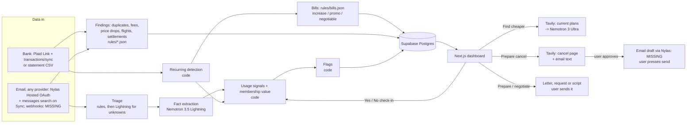

# ClawBack architecture

Status markers used here:
- **[built]**: in the prototype.
- **[stub]**: the code path exists but is untested or partial.
- **[MISSING]**: not started.

[STATUS.md](../STATUS.md) has the item-by-item list.

## 1. What it does

ClawBack looks for money in a person's own bank and email data. It finds every subscription and bill they pay for,
works out whether each one is worth it **for how they use it**, spots one-time money they are owed (duplicate
charges, bank fees, store price drops, flight refunds, class-action settlements), and does the legwork. Rocket Money
lists what you pay. ClawBack adds the usage side and the money owed, and then prepares the action:

| Situation | What ClawBack says | What it does |
|---|---|---|
| Membership costs more than it saves | "DashPass cost $9.99; 1 order saved you $2.99. Net -$7.00." | Break-even math, then cancel prep |
| Service looks unused | "Hulu sent a 'we miss you' email. It costs $9.99/month." | Asks to confirm, then cancel prep |
| Two plans do the same job | "You pay for iCloud+ and Google One storage." | Suggests keeping one |
| Trial about to convert | "Super Duolingo trial ends tomorrow, then $12.99/month." | Cancel prep before the charge |
| Price went up | "Netflix went from $15.49 to $17.99 on Sep 5." | Cheaper tier / alternatives |
| No usage evidence at all | "Did you use Adobe this month?" (one tap) | Remembers the answer |
| A bill stepped up | "Xfinity went from $55.00 to $85.00 a month (+55%). Your promotional rate ended Aug 8." | Negotiation script |
| Charged twice | "Best Buy charged $129.99 twice. Your email has one order." | Dispute letter (FCBA / Reg E) |
| A bank fee | "Overdraft fee: $35.00." | Courtesy-reversal request |
| A store dropped its price | "You paid $199.99; it's $169.99 now. Ask Target for $30 back by Oct 30." | Price-adjustment request |
| A flight was cancelled | "United cancelled UA 1532. You can ask for $412.40 back in cash." | Refund request citing the DOT rule |
| A settlement may apply | "You may qualify for the Kroger Savings Club settlement. Claim by Dec 21." | Official claim link only |

**ClawBack never cancels, sends, disputes or files anything itself.** It prepares the cancel link, the letter, the
request or the script (and later the email as a draft in the user's mailbox), and the user does the final click. That rule avoids three problems:
- holding everyone's passwords;
- wrong cancellations, such as stopping someone's phone backups;
- Google's requirement that users confirm agent actions on Workspace data.

**No affiliate money.** Recommendations are never paid placements.

## 2. Scope

**Hackathon demo (by 2026-10-30):** five areas from the same data (widened on 2026-10-22): subscriptions, bills,
bank charge problems, refunds owed, and class-action settlements (see §7). Bank data comes from Plaid Sandbox/Trial or
CSV upload, and email from any provider through Nylas (Sandbox: 5 accounts). It also includes the subscription flags
above, check-ins, "Find cheaper", "Prepare cancel", the findings with their prepared actions, the model trace, and a
seeded judge account.

**Roadmap:**
- a forwarding address for mail that can't be connected;
- the browser extension;
- state auto-renewal rules in claim text;
- a trained email classifier;
- notifications.

## 3. System overview

Everything that touches money or dates is plain code. Models only:
- read unstructured text (emails, plan pages);
- weigh options against usage;
- write wording.

A model never computes a date, a total or a deadline.

## 4. Data sources

### Bank and card transactions (the full subscription list)
- **Plaid** [built, untested live] (`backend/clawback/sources/plaid.py`, plain REST over httpx):
  - `POST /api/connect/plaid/link-token` calls `/link/token/create` (products `transactions`, 180 days, US, English).
  - Link runs in the browser and hands back a `public_token`. `POST /api/connect/plaid/exchange` swaps it for an
    access_token via `/item/public_token/exchange` and saves it (plaintext for now; encryption is [MISSING]).
  - Then the `/transactions/sync` cursor loop runs while `has_more`, applying added / modified / removed. A brand-new
    Item is often not ready: the first sync retries for about 15 s, then answers `pending: true` so the user can press
    Sync later. If Plaid reports a mutation during pagination, the loop restarts from its starting cursor.
  - Plaid amounts are positive for money out, the same as ours. The description is `merchant_name`, except that raw
    names our matchers rely on (`APPLE.COM/BILL`, `GOOGLE *...`, known merchants) are kept.
  - Transactions live in memory, so after a restart the first sync pulls from the start again.
  - Disconnect calls `/item/remove` (best effort) and drops the bank's transactions.
  - [MISSING]: the `SYNC_UPDATES_AVAILABLE` webhook (new data arrives only on Sync), Production access, and OAuth banks
    (Chase, Capital One and others need a redirect URI in Link plus a return page in the frontend).
  - Sandbox is free (test login `user_good` / `pass_good`; `user_transactions_dynamic` gives livelier data).
  - Plaid's `/transactions/recurring/get` is a paid add-on, so ClawBack uses its own recurring detection (below).
- **Statement CSV upload** [built]: works with no approvals. It handles common column names, a single amount column of
  either sign, and separate debit/credit columns. OFX is [MISSING].
- **App-store billing:** Apple and Google bill many subscriptions, which show up as `APPLE.COM/BILL` or `GOOGLE *`.
  No third-party API lists them. ClawBack names them by matching the Apple / Google Play receipt emails with the
  same amount (demo version [built], general version [MISSING]).

### Email (usage evidence, trials, receipts)
- **Any inbox through Nylas v3** [built, untested live] (`backend/clawback/sources/nylas.py`, plain REST over httpx).
  One "Connect email" button covers Gmail, Outlook / Hotmail / Microsoft 365, Yahoo, iCloud and other IMAP inboxes.
  - `GET /api/connect/email` returns the Nylas Hosted OAuth URL (`{NYLAS_API_URI}/v3/connect/auth`, `response_type=code`,
    `access_type=online`, an optional `login_hint`, and a random single-use `state` that expires after 10 minutes).
    No `provider` is sent, so Nylas shows its provider picker. The user signs in on the provider's own page.
  - Nylas redirects to `GET /api/connect/email/callback`. It checks the `state` and swaps the code at
    `POST /v3/connect/token` (client id, the API key as client secret) for a `grant_id`. The address and provider come
    from that response, or from `GET /v3/grants/{id}` when the response leaves them out. Then it saves the grant,
    reads mail, runs the pipeline, and redirects to `{FRONTEND_ORIGIN}/?connected=email` or `/?connect_error=<message>`.
    Nylas holds the provider tokens; ClawBack keeps only the grant id.
  - Reading: `GET /v3/grants/{id}/messages`, newest first, paged with `page_token` / `next_cursor`, up to
    `EMAIL_MAX_MESSAGES` (default 150) from the last 180 days. Nylas allows only `in`, `limit` and `page_token` next to
    `search_query_native` for Google and Microsoft, so:
    - Google: a Gmail-syntax search with `newer_than:180d` inside the query;
    - Microsoft: KQL keywords (Graph `$search`); the 180-day cut is made from each message's `date`;
    - Yahoo, iCloud, IMAP, EWS, or a native search the provider refuses: `received_after` plus the triage keyword rules,
      looking at up to 500 messages.
  - Each message keeps the first `from[].email`, `subject` and `date` (unix seconds). `body` is HTML when the message has
    an HTML part; it is stripped to text and cut to 5,000 characters, falling back to `snippet`. Bodies stay in memory.
  - A 401 / 404 on the grant marks the connection as needing a reconnect ("Connect email" again re-authenticates the
    same grant). A 429 waits for `Retry-After`, or backs off, and retries. Requests to one grant run one at a time.
  - Disconnect deletes the grant at Nylas (best effort) and drops the emails from memory. Connecting a different inbox
    deletes the old grant, because the Sandbox counts every grant toward its limit of 5.
- **Email drafts** [MISSING]: cancellation emails saved as drafts through the Nylas drafts API. Never send.
- **Email webhooks** [MISSING]: Nylas `message.created` webhooks, so new mail arrives without pressing Sync.
- **Nylas production** [MISSING]: the free Sandbox allows 5 connected accounts and isn't for production use.
  - Mail passes through Nylas, a third-party processor, so the privacy policy must say so.
  - Gmail in production also needs either our own Google project with Google verification + CASA (restricted
    scopes, renewed yearly) or Nylas's verified shared Google app (a paid add-on).
  - Google's Limited Use rules still apply to Gmail data: no training general models on user mail, a privacy policy
    that says so, a prompt-injection guard, and user confirmation for agent actions.
- **Forwarding address** [MISSING, P2]: a free Cloudflare Email Worker receives forwarded receipts from any provider.
  It can't write drafts into the user's mailbox, so the claim is emailed back to the user instead.
- iCloud and plain IMAP inboxes usually sign in with an app password on Nylas's page. ClawBack never sees it, but it
  gives Nylas full mailbox access, which the privacy policy should state.

## 5. Pipeline

| # | Stage | Engine | Runs on | Status |
|---|---|---|---|---|
| 1 | Triage: drop email that can't be about a subscription | Sender + keyword rules; Lightning for unknown senders | every email | [built] rules, [MISSING] Lightning fallback |
| 2 | Extraction: email -> facts (kind, merchant, amount, savings, old/new price, trial days left) | **Nemotron 3.5 Lightning** (`nvidia/Nemotron-3_5-Lightning`), Nano backup, regex fallback; cached per email | triage survivors | [built] |
| 2b | Receipts as PDFs/images | **Nemotron 3.5 Super-VL** on rendered pages | attachments | [MISSING] |
| 3 | Recurring detection | code: steady cadence + constant amount (or one lasting change) | all transactions | [built] |
| 4 | App-store resolution | code: match receipt emails by amount | `APPLE.COM/BILL`, `GOOGLE *` | [built] demo only |
| 5 | Usage signals | code (see §6) | each subscription | [built] |
| 6 | Membership value | code: savings from receipts minus the fee | delivery memberships | [built]; other memberships [MISSING] |
| 7 | Flags | code | each subscription | [built] |
| 8 | Find cheaper | **Tavily** search, **Nemotron 3 Super** reads the plans, **Nemotron 3 Ultra** (thinking on) fits them to usage, then a code citation check | on request | [built] |
| 9 | Prepare cancel | Tavily for the cancel page, **Ultra** writes the email (template fallback), a Nylas draft | on request | [built] / [MISSING] draft |
| 10 | Bills: classify + flag | code + `rules/bills.json` | recurring charges | [built] |
| 11 | Purchases and flight details from email | regex rules; **Nemotron 3.5 Lightning** with a key | receipt / order / airline emails | [built] rules, [stub] model |
| 12 | Findings: duplicates, fees, price drops, flights, settlements | code + `rules/*.json`; price checks with Tavily + Lightning | all transactions and emails | [built]; live price checks [stub] |

The funnel matters for cost:

$$C \approx N\,(c_{rules} + p\,c_{Lightning}) + k\,c_{Ultra}$$

- $N$: number of emails; $p$: share that survives triage; $k$: number of user-requested "find cheaper" runs.
- With about 1,000 input and 150 output tokens per email, Lightning costs about **$0.0001 per email**,
  so 1,000 emails cost about $0.10.
- An Ultra "find cheaper" call (~3k in, ~1.5k out) costs about **$0.0075**.
- A hosted ModernBERT classifier on the smallest Nebius CPU endpoint is about $0.066/h, roughly $1.60/day.
  It only beats Lightning above roughly 16,000 emails a day, so the trained classifier is P2.

## 6. Usage detection and "learning"

Bank data and email show what you pay, not what you use. ClawBack ranks its evidence:

| Strength | Signal | Example | Weight |
|---|---|---|---|
| Strong | Per-use receipts | DoorDash order emails | +1 each |
| Strong | User check-in | "Used it this month?" No | -2.5 (Yes: +2) |
| Medium | Inactivity email | "We miss you" | -1.5 |
| Weak | Engagement email | "Your top songs this week" | +0.5 |
| None | No evidence | Netflix, Adobe, ChatGPT | ask the user |

Rules:
- Sum the weights over the last 35 days (45 for inactivity emails).
- Negative with a "No" check-in means **none**; negative otherwise means **low**; positive means **normal**;
  no signals means **unknown**, plus a one-tap question.
- "Keep" silences usage flags for 90 days.

"Learning" today [built] means remembering check-in answers and keep decisions.

[MISSING]:
- learn how often to ask each user, and trust signal types per user;
- optional usage APIs (e.g. Spotify listening history);
- the browser extension, which sees actual visits to subscribed sites.

## 7. Bills and one-time money (findings)

All of this runs inside the same pipeline (`pipeline/run.py` -> `findings/detect.py`), in demo and real mode, on
Plaid / CSV transactions and Nylas email. Every rule comes from `backend/clawback/rules` (written and fact-checked
separately, each row with its `source_url`), read through `findings/rulebook.py`. Only `verified: true` rows can
raise a flag or a finding, and every finding and action cites its rule (name, summary, source URL) from that data.
All date and money math is code; models only read text (purchase and flight emails, prices on a page) or write wording.
Each detector writes one trace row with a count and a note.

Findings use one shape (`Finding`: kind, merchant, amount, currency, deadline, confidence, evidence, rule, status).
Ids are stable hashes of the kind and key facts, so "dismiss" and "done" survive re-runs. `owed_total` sums open USD
findings; EUR / GBP amounts say so in `amount_note`. "Done" takes a self-reported `got_back` amount, added to
`recovered_total` (MISSING [cancel-confirmation]: never checked against the bank). Every finding has a prepared
action (`ActionPrep`: channel, steps, verified links, a message and / or a script, the deadline, what's missing).

### 7.1 Bills (internet, mobile, insurance, utilities, gyms) [built]
- **Data in:** recurring charges whose description matches a provider in `rules/bills.json`, plus promo emails.
- **Rule:** bills.json says which providers are usually negotiable and which bills swing month to month (utilities).
- **Detector** (`findings/bills.py`; grouping in `pipeline/recurring.py`):
  - bills come out as `Subscription(kind="bill", bill_category=...)`, so they sit next to subscriptions and in the
    monthly total;
  - `bill_increase`: the median of the last 2 charges is 10%+ above the median of the earlier ones (high at 15%+),
    savings = the difference;
  - `promo_ending`: a "promotional rate ends" email whose date is still ahead;
  - `negotiable`: info only, when nothing else is flagged;
  - variable bills are detected despite swings and never get an increase flag.
- **Action:** `POST /api/subscriptions/{id}/negotiate`: phone or chat; talking points with the price now and before,
  how long they've been a customer (from the first charge) and the ask; a short chat message; the account and
  retention pages from bills.json.
- **MISSING:** [bill-market-rates] competitor offers (Tavily, untested).

### 7.2 Bank charge problems [built]
- **Duplicate charges.**
  - Data in: transactions, and purchases read from receipt emails.
  - Rule: `rules/disputes.json`. The Fair Credit Billing Act (credit card) and Regulation E (debit card) both give
    60 days after the statement that first shows the error.
  - Detector (`findings/charges.py`): same merchant (first two words) and amount within 3 days, $5+, not a recurring
    series or a fee. High confidence when one email receipt shows a single order; skipped when the emails show as
    many orders as charges.
  - Deadline: the statement date isn't known, so it assumes the statement closed at the end of the charge's month,
    then adds 60 days. It is labelled "estimated".
  - Action: ask the merchant first, then a written dispute letter to the card issuer before the deadline.
  - MISSING: [statement-dates] real statement dates and the card type.
- **Bank fees.**
  - Data in: transactions. Rule: `rules/bank_fees.json` (8 fee kinds, regex patterns, refunds excluded).
  - Detector: `fee_kind_for(description)`. The bank's name comes from the Plaid connection.
  - Action: a polite one-time courtesy-reversal message and phone script, using the neutral tip from the data.
    It never promises a result. No deadline.

### 7.3 Refunds owed [built]
- **Store price drops.**
  - Data in: purchases from receipt / order emails (`findings/purchases.py`: regex rules; Nemotron 3.5 Lightning with a
    key, copying names and prices only), plus a current-price check (`tools/prices.py`).
  - Rule: `rules/retailers.json`: does the store adjust, the window in days, from purchase or delivery, conditions and
    exclusions, how to claim.
  - Detector (`findings/refunds.py`): stores that adjust only (Walmart and Amazon never). Deadline = order date + window,
    counted from the order date even when the store counts from delivery (unknown). A finding needs a $5+ drop on or
    before the deadline.
  - Price check: simulated in demo mode (`demo_data.PRICE_CHECKS`, labelled in the evidence and trace). In real mode,
    Tavily search + extract on the store's site and Lightning reading the price, with a cited page. Without keys, no
    check and a MISSING trace row.
  - Action: the store's own claim route (chat, phone, in store or form, from the data), its claim link, and a request
    with the order number and both prices.
  - Special cases from the data:
    - stores that refuse requests filed by services (Nordstrom) get a reminder to ask themselves, with no drafted
      message;
    - store-purchase-only policies (Staples) are low confidence;
    - windows that count from delivery (Best Buy, Apple) start at the order date, the earliest possible, and the
      evidence says so;
    - rows last checked more than ~3 months ago carry a "check the official page" note.
  - MISSING: [live-price-check] (untested), [purchase-extraction] (regex only without a key).
- **Flights.**
  - Data in: airline emails. A booking gives the fare; a cancellation or schedule change gives the event (flight
    number, route, date, old and new times, whether a credit was offered or a change accepted).
  - Rules: `rules/flights.json`.
    - US DOT (14 CFR 260): a cash refund for a cancellation, or a change of 3+ hours domestic / 6+ hours international,
      unless the passenger accepted the alternative or a voucher.
    - EU261 / UK261: fixed compensation by great-circle distance band (`findings/airports.py`) for a cancellation
      with under 14 days' notice, on flights leaving the EU / UK. A 3+ hour change gets the same treatment, at low
      confidence.
  - Action: the airline's refund or claim page (when listed in flights.json) and a request citing the rule.
  - MISSING: [flight-status-check] (real arrival delays and causes); EU-airline arrivals into the EU aren't checked.

### 7.4 Class-action settlements [built]
- **Data in:** transaction descriptions, email senders and subjects.
- **Rule:** `rules/settlements.json`, a curated list of open settlements with the official claim site.
- **Detector** (`findings/settlements.py`): `settlements_matching()` over each charge and email.
  - Confidence is medium when a dated purchase falls inside the class period and the class isn't limited to one
    state or venue (SeatGeek Nevada events, Schnucks Missouri stores, Knott's California, ...), otherwise low
    ("might apply").
  - Amount = the payout estimate (or 0), with the payout text as the note. Deadline = the claim deadline.
- **Action:** who qualifies, the proof needed, and the official `claim_url` as the only link. It notes that claims are
  made under penalty of perjury. When the claim needs a Claim ID / PIN from a mailed notice (TED, LiveHealth,
  Equifax, Navy Federal...), the steps say so. ClawBack never files or pre-fills a claim.
- **MISSING:** [settlements-refresh] no live feed. Matching is by merchant name, so it can hit a settlement about a
  different product from the same company.

## 8. Model roles (Nebius Token Factory, OpenAI-compatible, `https://api.tokenfactory.nebius.com/v1/`)

| Role | Model ID | $/1M in/out | Context | Why |
|---|---|---|---|---|
| Extraction, triage fallback | `nvidia/Nemotron-3_5-Lightning` | 0.06 / 0.24 | 1M | About 5× Nano's speed at the same price |
| Fallback | `nvidia/NVIDIA-Nemotron-3-Nano-30B-A3B` | 0.06 / 0.24 | 262k | Nebius is steering users to Lightning |
| Plan / policy pages | `nvidia/nemotron-3-super-120b-a12b` | 0.30 / 0.90 | 262k | Cheap long-document reading |
| Fit-to-usage reasoning, wording | `nvidia/Nemotron-3-Ultra-550b-a55b` | 1.00 / 3.00 | 1M | Strongest reasoning; runs only on request |
| Receipt images / PDF pages | `nvidia/Nemotron-3.5-Super-VL` | 0.30 / 0.90 | 1M | The only NVIDIA vision model on Token Factory |

Source: the public catalog at `https://tokenfactory.nebius.com/api/public/models_info` (checked 2026-10-22).
Nemotron 3 Nano Omni was removed on 2026-08-31.

Verified live on 2026-10-22 (one call per model; rerun with `python -m clawback.llm --check`):

| Model | Strict JSON (`response_format: json_schema`) | Thinking on |
|---|---|---|
| Lightning | works | **breaks output**: reasoning is written into `content` with no tags. Never enabled. |
| Nano | works | content stays clean |
| Super | works, also with thinking on | reasoning in `message.reasoning_content` |
| Ultra | works, also with thinking on | reasoning in `message.reasoning_content` |
| Super-VL | works (text only tested) | reasoning in `message.reasoning_content` |

Each tier has a backup (`fast` → `fast_fallback`) or a code fallback (regexes, template, hints), one retry on
rate limits / server errors, and a timeout. See `backend/clawback/llm.py` (`TIERS`).

**Zero Data Retention must be on** before any real user email is sent. Without it, Token Factory keeps inputs and
outputs and logs them.

## 9. Data model (target: Supabase Postgres with row-level security)

| Table | Key fields | Notes |
|---|---|---|
| users | id, email, state (for auto-renewal law) | Supabase Auth |
| connections | user_id, kind (email/plaid), Nylas grant_id + provider / encrypted Plaid token, cursor | tokens encrypted at rest. The prototype keeps these in `backend/.local/connections.json`, in plaintext [MISSING: token-encryption] |
| transactions | user_id, date, description, amount, source | minimal fields only |
| email_facts | user_id, received, kind, merchant, amounts, trial_end | **no raw email bodies stored** |
| subscriptions | user_id, merchant, category, kind (subscription / bill), bill_category, cadence, amount, monthly_cost, next_expected, status, price_change | rebuilt by the pipeline |
| findings | user_id, id (stable hash), kind, merchant, amount, currency, deadline, confidence, evidence, rule, status, got_back | rebuilt by the pipeline; status and got_back are the user's |
| usage_signals | subscription_id, kind, on, weight, detail | evidence shown to the user |
| decisions | subscription_id, kind (checkin_yes / checkin_no / keep / cancel_started / cancel_confirmed), on | the "memory" |
| actions | subscription_id, kind (cancel_prep / alternatives / email_draft), payload, created | what ClawBack prepared |
| trace | user_id, stage, engine, status, ms, tokens, cost | shown on the dashboard |

The prototype keeps all of this in memory for a single demo user [MISSING: database, auth]. Only `connections`
survives a restart (the JSON file above). On startup, saved connections switch the user to real data and sync again.

Each user has a **mode**: `demo` (seeded fake data, the default) or `real`. The first real connection while in demo
mode drops the demo transactions, emails, subscriptions and decisions, so real and fake data never mix. Uploaded
statements are kept. `POST /api/demo/seed` switches back to demo; saved connections stay saved but unused.

## 10. API (FastAPI)

| Method | Path | Does | Status |
|---|---|---|---|
| GET | /api/health | Connected services + model roles | [built] |
| GET | /api/missing | Everything not built | [built] |
| GET | /api/features | Every planned feature and its phase, for the build-status board | [built] |
| GET | /api/summary | Subscriptions and bills (counts, totals), monthly total, potential savings, flagged, owed (open findings, USD), recovered (self-reported) | [built] |
| GET | /api/subscriptions | Subscriptions sorted by savings | [built] |
| POST | /api/subscriptions/{id}/checkin `{used}` | Record a check-in, re-run | [built] |
| POST | /api/subscriptions/{id}/keep | Keep; silence usage flags 90 days | [built] |
| POST | /api/subscriptions/{id}/cancel-prep | Link, steps, email | [stub] |
| GET | /api/subscriptions/{id}/alternatives | Hints, plus Tavily + Ultra options with citations | [stub] |
| POST | /api/subscriptions/{id}/email-draft | Save the email as a draft in the user's mailbox | [MISSING] (501) |
| POST | /api/subscriptions/{id}/negotiate | `ActionPrep`: script, chat message, provider links | [built] |
| GET | /api/findings | `Finding[]`: open first, then deadline (soonest, none last), then amount | [built] |
| POST | /api/findings/{id}/prepare | `ActionPrep` for that finding | [built] |
| POST | /api/findings/{id}/dismiss | The updated finding | [built] |
| POST | /api/findings/{id}/done `{got_back}` | The updated finding; adds got_back to recovered (self-reported) | [built] |
| POST | /api/ingest/statement | CSV upload (demo or real mode) | [built] |
| GET | /api/connections | Mode + each connection: configured, connected, account / provider / institution, last sync, error | [built] |
| GET | /api/connect/email `?login_hint=` | `{auth_url}` for Nylas Hosted OAuth; 501 naming the env vars when not configured | [built] |
| GET | /api/connect/email/callback | OAuth return: state check, grant, read mail, pipeline, 302 back to the app | [built] |
| POST | /api/connect/plaid/link-token | `{link_token}` for Plaid Link; 501 when not configured | [built] |
| POST | /api/connect/plaid/exchange `{public_token, institution}` | Save the bank, first sync, pipeline: `{added_transactions, institution, pending}` | [built] |
| POST | /api/connect/email/disconnect, /api/connect/plaid/disconnect | Forget the connection, tell Nylas / Plaid, drop that data | [built] |
| POST | /api/ingest/email/webhook, /api/ingest/plaid/webhook | Webhook receivers | [MISSING] (501) |
| POST | /api/sync | Real mode: pull every connected source, then re-run. Demo mode: re-run | [built] |
| POST | /api/demo/seed | Switch to demo mode and reseed | [built] |
| GET | /api/trace | Model trace | [built] |

## 11. Frontend (Next.js)

Two pages today [built] (design rules in `docs/DESIGN.md`):
- `/`, the front page: what ClawBack does, shown on one demo month of statement lines, the five areas, how it works,
  which model does what, the trust rules, and a pointer to the build status;
- `/dashboard`: connect buttons and a statement upload; one sentence about the month and the spend bar; money owed
  to you; subscriptions and bills grouped by what to do, with evidence, Yes/No check-in, Keep, Find cheaper,
  Prepare cancel and Negotiate; the build status of every planned feature (`GET /api/features`); the model trace.

[MISSING]:
- login, plus a demo login for judges;
- an onboarding flow (connect bank, connect email, first scan);
- a "recovered" history;
- a settings page (state, notification preferences, disconnect and delete data).

## 12. Security and privacy

- Email is read-only today; drafts later, and ClawBack never sends.
- Mail passes through Nylas, a third-party processor; the privacy policy must say so [MISSING: nylas-production].
- Store extracted facts, not raw email bodies. Today bodies live only in memory and are never written to disk or the
  trace. Trace notes never contain tokens, secrets or the API key.
- Encrypt the Plaid token and Nylas grant id [MISSING]: they are plaintext in `backend/.local/connections.json`
  (git-ignored). A grant id only works together with `NYLAS_API_KEY`, which stays in `backend/.env`.
- Disconnect deletes the Nylas grant or removes the Plaid Item, and drops that source's data [built]. Deleting
  everything for a user is [MISSING] (needs the database).
- The OAuth callback checks a random single-use `state` (CSRF). Errors go back to the app as a short message,
  never a stack trace.
- Token Factory Zero Data Retention on [MISSING]. Token Factory never trains on prompts.
- Email text is wrapped as untrusted data, and the model is told to ignore instructions inside it. A real injection
  screen is [MISSING].
- Links shown to users are either verified (Apple / Google Play subscription pages), Tavily results labelled
  "unverified", or citations the code checks against Tavily's results. A model can't introduce a URL.
- No user data is used to train anything. A classifier, if trained, uses public and synthetic emails only.

## 13. Testing and evaluation

- [built] 8 tests on the demo data: every flag fires where it should, noise isn't detected, the DashPass math is right,
  check-ins change the result, the CSV parser handles signs, and unbuilt routes return 501.
- [built] 26 tests on email (Nylas) and Plaid against fake APIs (`httpx.MockTransport`, no network, connections file
  in a temp dir): auth URL and state checks, token exchange and the grant lookup, message mapping (HTML body, plain
  body, snippet fallback), the Google / Microsoft / other-provider read paths, paging, 429 retry, expired grants,
  disconnect and old-grant cleanup, Plaid mapping, sync with changes and removals, the "not ready yet" wait, clean
  Plaid errors, 501 messages when unconfigured, the demo -> real switch and back, startup restore, and the `.env` reader.
- [built] 26 tests on bills and findings: each detector on small inline rule data, including the negative cases
  (Walmart not flagged, utility swings not flagged, a recurring series not counted as a duplicate, $4.99 drops, 2.5 h /
  5 h changes, 14+ days' notice) and the deadline boundaries (last day open, next day closed). They also cover every
  findings route, stable ids across re-runs, the rules data's special cases (self-file stores, store-only policies,
  state-limited settlements, notice codes, the package's fee exclusions and longest match), and the demo story on the
  real rules data.
- [built] `tests/test_rules.py` (written with the rules data) checks every rules file loads, URLs are https, and the
  helpers match.
- [built] 49 tests on the model layer with a fake OpenAI client (`tests/fakes.py`): the tier table, strict JSON and
  the thinking flag, the Nano fallback, one retry on rate limits and none on timeouts, extraction (cached per email,
  dates computed in code, merchant names mapped, rules when every model fails), "find cheaper" (Super then Ultra,
  every option checked against its cited page), the Ultra cancel email and its checks, click-time trace rows
  surviving a re-run, and `.env` loading. Two more check that sync rows survive a re-run too, and that
  demo rows go when real data arrives.
- [built] An opt-in live check (`CLAWBACK_LIVE=1 pytest tests/test_live.py`): Lightning against the regex rules on
  the demo emails.
- [MISSING] Fake-model tests for the findings' model calls (purchases, flight details, price checks).
- [MISSING] A live run against a Nylas Sandbox app and Plaid Sandbox.
- [MISSING] A labelled evaluation set: synthetic inboxes and transaction histories with known subscriptions and usage.
  Measure subscriptions found, false flags, and cost per 1,000 emails (rules + Lightning vs. everything to Ultra).
  Publish the failure cases.
- [MISSING] A run on the team's own accounts, to report real savings found.

## 14. Hackathon requirement mapping (Nebius x NVIDIA Global AI Hackathon, Best Apps and Agents)

| Requirement | How ClawBack meets it | Status |
|---|---|---|
| Runtime call to Nebius Token Factory | Extraction (Lightning), find cheaper (Super, Ultra), the cancel email (Ultra) | [built]: all five tiers called live 2026-10-22 |
| At least one NVIDIA open model | Nemotron 3.5 Lightning, Nemotron 3 Nano, Nemotron 3 Super, Nemotron 3 Ultra (Nemotron 3.5 Super-VL planned) | [built] |
| Track fit: an app someone would use; Ultra for reasoning, Nano/Super for fast calls | Model routing in §8 | [built] in code |
| Working demo URL until Dec 15 | Vercel frontend + hosted backend + seeded judge login | [MISSING] |
| Public repo with an OSI license | MIT or Apache-2.0 | [MISSING]: private on purpose for now |
| README with setup + how Nemotron / Token Factory are used | README.md | [built], update after live calls |
| Video under 3 minutes | "aha" within 30 s: the DashPass net-loss card | [MISSING] |
| Feedback on Token Factory / NVIDIA models | Notes kept while building: `docs/token-factory-feedback.md` | [stub]: notes started |
| Tavily bonus ($3k) | Find cheaper, cancel-page lookup, bill competitor offers, store price checks | [built] find cheaper; [stub] the rest |

## 15. Suggested build order for the remaining days

1. **Keys:** Nebius and Tavily keys are in, and one live call per model confirmed the JSON and thinking behaviour
   (done 2026-10-22). Still to do: turn on ZDR, then run extraction and "find cheaper" on real mail.
2. **Plaid:** Sandbox Link + `/transactions/sync` into the existing recurring detection (built; try it live with
   Sandbox keys). Supabase schema + auth.
3. **Email:** Nylas Hosted OAuth and a manual Sync (built; try it live with a Sandbox app), then webhooks, Lightning
   extraction, drafts.
4. **Cancel lookup:** Tavily lookup with citations. Build the evaluation set and measure.
5. **Deploy:** frontend on Vercel, backend hosted (a Nebius Serverless CPU endpoint is about $0.066/h, or a free
   host). Seed the judge account. A daily check that the Nylas grant is still valid.
6. **Real data:** run on your own accounts and record real numbers. Polish the UI.
7. **Package:** video, write-up, LICENSE, make the repo public, submit a day early.
