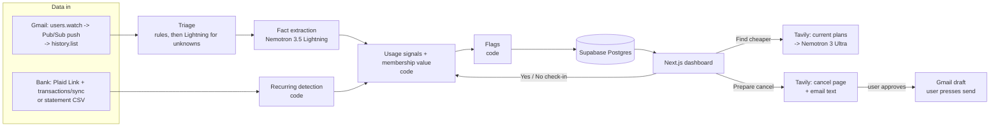

# ClawBack architecture

Status markers used here:
- **[built]**: in the prototype.
- **[stub]**: the code path exists but is untested or partial.
- **[MISSING]**: not started.

[STATUS.md](../STATUS.md) has the item-by-item list.

## 1. What it does

ClawBack finds every subscription a person pays for, works out whether each one is worth it **for how they use it**,
and does the legwork when it isn't. Rocket Money lists what you pay. ClawBack adds the usage side and then acts:

| Situation | What ClawBack says | What it does |
|---|---|---|
| Membership costs more than it saves | "DashPass cost $9.99; 1 order saved you $2.99. Net -$7.00." | Break-even math, then cancel prep |
| Service looks unused | "Hulu sent a 'we miss you' email. It costs $9.99/month." | Asks to confirm, then cancel prep |
| Two plans do the same job | "You pay for iCloud+ and Google One storage." | Suggests keeping one |
| Trial about to convert | "Super Duolingo trial ends tomorrow, then $12.99/month." | Cancel prep before the charge |
| Price went up | "Netflix went from $15.49 to $17.99 on Sep 5." | Cheaper tier / alternatives |
| No usage evidence at all | "Did you use Adobe this month?" (one tap) | Remembers the answer |

**ClawBack never cancels or sends anything itself.** It prepares the cancel link, the steps and the email (as a
Gmail draft), and the user does the final click. That rule avoids three problems:
- holding everyone's passwords;
- wrong cancellations, such as stopping someone's phone backups;
- Google's requirement that users confirm agent actions on Workspace data.

**No affiliate money.** Recommendations are never paid placements.

## 2. Scope

**Hackathon demo (by 2026-10-30):** subscriptions only. Bank data comes from Plaid Sandbox/Trial or CSV upload,
and email from Gmail in Google's Testing mode. It also includes the five flags above, check-ins, "Find cheaper",
"Prepare cancel" with a Gmail draft, the model trace, and a seeded judge account.

**Roadmap:**
- price-drop refunds, flight refunds and duplicate charges (research done, rules known);
- Outlook;
- a forwarding address for other providers;
- the browser extension;
- state auto-renewal rules in claim text;
- a trained email classifier;
- notifications.

## 3. System overview

Everything that touches money or dates is plain code. Models only:
- read unstructured text (emails, plan pages);
- weigh options against usage;
- write wording.

A model never computes a date, a total or a deadline.

## 4. Data sources

### Bank and card transactions (the full subscription list)
- **Plaid** [MISSING]: Link in the browser, then a public_token exchange for an access_token (stored encrypted), then the
  `/transactions/sync` cursor loop, re-run on the `SYNC_UPDATES_AVAILABLE` webhook.
  - Sandbox is free (test user `user_transactions_dynamic`).
  - The Trial plan allows 10 real bank connections free.
  - Plaid's `/transactions/recurring/get` is a paid add-on, so ClawBack uses its own recurring detection (below).
- **Statement CSV upload** [built]: works with no approvals. It handles common column names, a single amount column of
  either sign, and separate debit/credit columns. OFX is [MISSING].
- **App-store billing:** Apple and Google bill many subscriptions, which show up as `APPLE.COM/BILL` or `GOOGLE *`.
  No third-party API lists them. ClawBack names them by matching the Apple / Google Play receipt emails with the
  same amount (demo version [built], general version [MISSING]).

### Email (usage evidence, trials, receipts)
- **Gmail** [MISSING]: OAuth with `gmail.readonly` (read) + `gmail.compose` (drafts).
  - Both are **restricted** scopes. Until a paid CASA security review passes (weeks), the app stays in Testing mode:
    at most 100 test users, whose tokens expire 7 days after consent.
  - Push: `users.watch` publishes to a Pub/Sub topic (grant publish to `gmail-api-push@system.gserviceaccount.com`).
    Each push carries only `{emailAddress, historyId}`; call `history.list` from the last stored id.
    Renew the watch daily, and poll `history.list` now and then, because pushes can be dropped.
  - Drafts: `drafts.create` only, never `messages.send`.
  - Google's Limited Use rules apply: no training general models on user mail, a privacy policy that says so,
    a prompt-injection guard, and user confirmation for agent actions.
- **Outlook** [MISSING, P2]: Microsoft Graph with `Mail.Read` + `Mail.ReadWrite` (drafts). `Mail.ReadWrite` cannot send,
  so "draft only" is enforced by the permission. Message subscriptions last under 7 days and must be renewed.
- **Forwarding address** [MISSING, P2]: a free Cloudflare Email Worker receives forwarded receipts from any provider.
  It can't write drafts into the user's mailbox, so the claim is emailed back to the user instead.
- Yahoo / iCloud app passwords: **deliberately not supported**. They give full mailbox access with no limits.

## 5. Pipeline

| # | Stage | Engine | Runs on | Status |
|---|---|---|---|---|
| 1 | Triage: drop email that can't be about a subscription | Sender + keyword rules; Lightning for unknown senders | every email | [built] rules, [MISSING] Lightning fallback |
| 2 | Extraction: email -> facts (kind, merchant, amount, savings, old/new price, trial days left) | **Nemotron 3.5 Lightning** (`nvidia/Nemotron-3_5-Lightning`) | triage survivors | [stub] (regexes stand in) |
| 2b | Receipts as PDFs/images | **Nemotron 3.5 Super-VL** on rendered pages | attachments | [MISSING] |
| 3 | Recurring detection | code: steady cadence + constant amount (or one lasting change) | all transactions | [built] |
| 4 | App-store resolution | code: match receipt emails by amount | `APPLE.COM/BILL`, `GOOGLE *` | [built] demo only |
| 5 | Usage signals | code (see §6) | each subscription | [built] |
| 6 | Membership value | code: savings from receipts minus the fee | delivery memberships | [built]; other memberships [MISSING] |
| 7 | Flags | code | each subscription | [built] |
| 8 | Find cheaper | **Tavily** search, then **Nemotron 3 Ultra** (`nvidia/Nemotron-3-Ultra-550b-a55b`), then a code citation check | on request | [stub] |
| 9 | Prepare cancel | Tavily for the cancel page, a template or Ultra for the email, Gmail `drafts.create` | on request | [stub] / [MISSING] draft |

The funnel matters for cost:

$$C \approx N\,(c_{rules} + p\,c_{Lightning}) + k\,c_{Ultra}$$

- $N$: number of emails; $p$: share that survives triage; $k$: number of user-requested "find cheaper" runs.
- With about 1,000 input and 150 output tokens per email, Lightning costs about **$0.0001 per email**,
  so 1,000 emails cost about $0.10.
- An Ultra "find cheaper" call (~3k in, ~1.5k out) costs about **$0.0075**.
- A hosted ModernBERT classifier on the smallest Nebius CPU endpoint is about $0.066/h, roughly $1.60/day.
  It only beats Lightning above roughly 16,000 emails a day, so the trained classifier is P2.

## 6. Usage detection and "learning"

Bank data and email show what you pay, not what you use. ClawBack ranks its evidence:

| Strength | Signal | Example | Weight |
|---|---|---|---|
| Strong | Per-use receipts | DoorDash order emails | +1 each |
| Strong | User check-in | "Used it this month?" No | -2.5 (Yes: +2) |
| Medium | Inactivity email | "We miss you" | -1.5 |
| Weak | Engagement email | "Your top songs this week" | +0.5 |
| None | No evidence | Netflix, Adobe, ChatGPT | ask the user |

Rules:
- Sum the weights over the last 35 days (45 for inactivity emails).
- Negative with a "No" check-in means **none**; negative otherwise means **low**; positive means **normal**;
  no signals means **unknown**, plus a one-tap question.
- "Keep" silences usage flags for 90 days.

"Learning" today [built] means remembering check-in answers and keep decisions.

[MISSING]:
- learn how often to ask each user, and trust signal types per user;
- optional usage APIs (e.g. Spotify listening history);
- the browser extension, which sees actual visits to subscribed sites.

## 7. Model roles (Nebius Token Factory, OpenAI-compatible, `https://api.tokenfactory.nebius.com/v1/`)

| Role | Model ID | $/1M in/out | Context | Why |
|---|---|---|---|---|
| Extraction, triage fallback | `nvidia/Nemotron-3_5-Lightning` | 0.06 / 0.24 | 1M | About 5× Nano's speed at the same price |
| Fallback | `nvidia/NVIDIA-Nemotron-3-Nano-30B-A3B` | 0.06 / 0.24 | 262k | Nebius is steering users to Lightning |
| Plan / policy pages | `nvidia/nemotron-3-super-120b-a12b` | 0.30 / 0.90 | 262k | Cheap long-document reading |
| Fit-to-usage reasoning, wording | `nvidia/Nemotron-3-Ultra-550b-a55b` | 1.00 / 3.00 | 1M | Strongest reasoning; runs only on request |
| Receipt images / PDF pages | `nvidia/Nemotron-3.5-Super-VL` | 0.30 / 0.90 | 1M | The only NVIDIA vision model on Token Factory |

Source: the public catalog at `https://tokenfactory.nebius.com/api/public/models_info` (checked 2026-10-22).
Nemotron 3 Nano Omni was removed on 2026-08-31.

Not verified yet [MISSING]: whether Token Factory honours `response_format: json_schema` and
`chat_template_kwargs.enable_thinking` for these models. The client asks for JSON in the prompt as well and parses
defensively.

**Zero Data Retention must be on** before any real user email is sent. Without it, Token Factory keeps inputs and
outputs and logs them.

## 8. Data model (target: Supabase Postgres with row-level security)

| Table | Key fields | Notes |
|---|---|---|
| users | id, email, state (for auto-renewal law) | Supabase Auth |
| connections | user_id, provider (gmail/plaid), encrypted_token, cursor / history_id, expires_at | tokens encrypted at rest |
| transactions | user_id, date, description, amount, source | minimal fields only |
| email_facts | user_id, received, kind, merchant, amounts, trial_end | **no raw email bodies stored** |
| subscriptions | user_id, merchant, category, cadence, amount, monthly_cost, next_expected, status, price_change | rebuilt by the pipeline |
| usage_signals | subscription_id, kind, on, weight, detail | evidence shown to the user |
| decisions | subscription_id, kind (checkin_yes / checkin_no / keep / cancel_started / cancel_confirmed), on | the "memory" |
| actions | subscription_id, kind (cancel_prep / alternatives / gmail_draft), payload, created | what ClawBack prepared |
| trace | user_id, stage, engine, status, ms, tokens, cost | shown on the dashboard |

The prototype keeps all of this in memory for a single demo user [MISSING: database, auth].

## 9. API (FastAPI)

| Method | Path | Does | Status |
|---|---|---|---|
| GET | /api/health | Connected services + model roles | [built] |
| GET | /api/missing | Everything not built | [built] |
| GET | /api/summary | Monthly total, potential savings, flagged count, recovered | [built] (recovered always $0) |
| GET | /api/subscriptions | Subscriptions sorted by savings | [built] |
| POST | /api/subscriptions/{id}/checkin `{used}` | Record a check-in, re-run | [built] |
| POST | /api/subscriptions/{id}/keep | Keep; silence usage flags 90 days | [built] |
| POST | /api/subscriptions/{id}/cancel-prep | Link, steps, email | [stub] |
| GET | /api/subscriptions/{id}/alternatives | Hints, plus Tavily + Ultra options with citations | [stub] |
| POST | /api/subscriptions/{id}/gmail-draft | Save the email as a Gmail draft | [MISSING] (501) |
| POST | /api/ingest/statement | CSV upload | [built] |
| GET | /api/connect/gmail, /api/connect/plaid | Start OAuth / Link | [MISSING] (501) |
| POST | /api/ingest/gmail/push, /api/ingest/plaid/webhook | Push / webhook receivers | [MISSING] (501) |
| POST | /api/sync, /api/demo/seed | Re-run / reset demo | [built] |
| GET | /api/trace | Model trace | [built] |

## 10. Frontend (Next.js)

One page today [built]:
- a header with connect buttons (showing "missing") and a statement upload;
- the MISSING banner;
- totals;
- subscription cards with flags, evidence, Yes/No check-in, Keep, Find cheaper and Prepare cancel;
- the model trace.

[MISSING]:
- login, plus a demo login for judges;
- an onboarding flow (connect bank, connect Gmail, first scan);
- a "recovered" history;
- a settings page (state, notification preferences, disconnect and delete data).

## 11. Security and privacy

- Draft-only email permissions. Never `messages.send`.
- Store extracted facts, not raw email bodies. Encrypt OAuth and Plaid tokens. Delete everything on disconnect [MISSING].
- Token Factory Zero Data Retention on [MISSING]. Token Factory never trains on prompts.
- Email text is wrapped as untrusted data, and the model is told to ignore instructions inside it. A real injection
  screen is [MISSING].
- Links shown to users are either verified (Apple / Google Play subscription pages), Tavily results labelled
  "unverified", or citations the code checks against Tavily's results. A model can't introduce a URL.
- No user data is used to train anything. A classifier, if trained, uses public and synthetic emails only.

## 12. Testing and evaluation

- [built] 8 tests on the demo data: every flag fires where it should, noise isn't detected, the DashPass math is right,
  check-ins change the result, the CSV parser handles signs, and unbuilt routes return 501.
- [MISSING] A labelled evaluation set: synthetic inboxes and transaction histories with known subscriptions and usage.
  Measure subscriptions found, false flags, and cost per 1,000 emails (rules + Lightning vs. everything to Ultra).
  Publish the failure cases.
- [MISSING] A run on the team's own accounts, to report real savings found.

## 13. Hackathon requirement mapping (Nebius x NVIDIA Global AI Hackathon, Best Apps and Agents)

| Requirement | How ClawBack meets it | Status |
|---|---|---|
| Runtime call to Nebius Token Factory | Extraction (Lightning) and alternatives (Ultra) | [stub]: needs a key and a live test |
| At least one NVIDIA open model | Nemotron 3.5 Lightning, Nemotron 3 Ultra, Nemotron 3.5 Super-VL | [stub] |
| Track fit: an app someone would use; Ultra for reasoning, Nano/Super for fast calls | Model routing in §7 | [built] in code |
| Working demo URL until Dec 15 | Vercel frontend + hosted backend + seeded judge login | [MISSING] |
| Public repo with an OSI license | MIT or Apache-2.0 | [MISSING]: private on purpose for now |
| README with setup + how Nemotron / Token Factory are used | README.md | [built], update after live calls |
| Video under 3 minutes | "aha" within 30 s: the DashPass net-loss card | [MISSING] |
| Feedback on Token Factory / NVIDIA models | Keep notes while building | [MISSING] |
| Tavily bonus ($3k) | Find cheaper + cancel-page lookup | [stub] |

## 14. Suggested build order for the remaining days

1. **Keys:** get Nebius (turn on ZDR) and Tavily keys. Run one live call per model; confirm JSON and thinking
   behaviour. Exercise the extraction and "find cheaper" paths for real.
2. **Plaid:** Sandbox Link + `/transactions/sync` into the existing recurring detection. Supabase schema + auth.
3. **Gmail:** OAuth in Testing mode, a manual "sync now" (`history.list`), Lightning extraction, `drafts.create`.
4. **Cancel lookup:** Tavily lookup with citations. Build the evaluation set and measure.
5. **Deploy:** frontend on Vercel, backend hosted (a Nebius Serverless CPU endpoint is about $0.066/h, or a free
   host). Seed the judge account. A daily health check on the Gmail token, which expires every 7 days.
6. **Real data:** run on your own accounts and record real numbers. Polish the UI.
7. **Package:** video, write-up, LICENSE, make the repo public, submit a day early.
